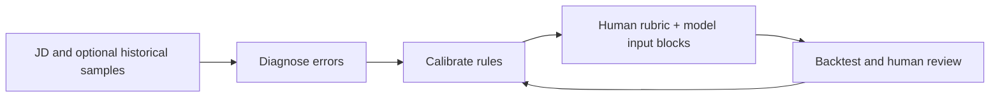

<div align="center">

# JD Evaluation Calibrator

### When the model is frozen, improve the evaluation criteria.

Turn ambiguous job descriptions into explicit rules an AI evaluator can follow.

[简体中文](README.md) · **English**


[Get the Skill](jd-eval-calibrator%20%282%29.skill) · [See an example](#see-an-example) · [Quick start](#quick-start) · [Read the source](jd-eval-calibrator/SKILL.md)

</div>

## See an example

A human reviewer may read “preferred” as a bonus, while a model treats it as a rejection rule. This project makes that distinction explicit.

| Original JD | Calibrated rule |
| --- | --- |
| “Knowledge-base project experience preferred” | Treat this experience as a bonus. **Its absence must not be a rejection reason.** |
| “Proficiency in Markdown, Notion, and similar tools” | Tool names are examples. **Equivalent work completed with other tools can also provide capability evidence.** |

*Manually authored illustration, not a measured model output.* [See the complete input and two-box output →](examples/jd-before-after.md)

## Why use it

For HR teams, AI evaluation operators, and vendor-standard designers, especially when **model weights and system prompts are frozen and only JD input fields can be edited**.

- **Reduce rule misinterpretation:** distinguish mandatory gates, bonus signals, experience tiers, and equivalent capabilities using 17 documented error patterns.
- **Align execution standards:** generate a weighted rubric for people and two input text blocks for models from the same business criteria.
- **Make changes testable:** calibrate and backtest when samples exist; mark defaults as pending validation when they do not. Use disagreements to guide the next revision.

## Results

| 55% → 70% | 17 patterns | 2 modes |
| :---: | :---: | :---: |
| Reported AI–human agreement, **+15 percentage points** | Misjudgment patterns and correction rules | Sample-based calibration / JD-only rewriting |

Agreement figures come from the author's records for a specific business setting. The dataset, sample size, and complete configuration are not public, so the result is not independently reproducible and does not establish general recruiting accuracy. [Metric definitions and evidence scope →](docs/evaluation.md)

**My contribution:** primary contributor and AI evaluation workflow designer, covering error analysis, criteria calibration, Skill packaging, and backtesting methodology, plus Error Case RAG architecture design and interface feasibility assessment.

## How it works



**With samples → Calibration mode:** derive evidence requirements, tiers, and boundary rules from human-labeled examples. Produce criteria, a backtest table, and two-box prompts. The Skill recommends at least five samples to start; independent evaluation requires a separate holdout set.

**JD only → Rewrite mode:** diagnose ambiguity and generate default criteria and two-box prompts, marked as pending sample backtesting.

One key tradeoff: **retain numeric weights in the human rubric, but use qualitative tiers in the default model input**, to avoid conflicting with the model's existing scoring conventions. [Design rationale and full workflow →](docs/design.md)

## Quick start

**1. Get it.** [Download the Skill package](jd-eval-calibrator%20%282%29.skill) and import it into a compatible host, or browse the [source directory](jd-eval-calibrator). The host must provide an LLM, file reading, and document tools; installation depends on the host. Skill instructions and supporting documents are primarily in Chinese.

**2. Ask.** Start with a JD in rewrite mode:

```text
Use jd-eval-calibrator to rewrite the JD below.
Identify requirements an AI evaluator could misinterpret.
Produce evaluation criteria and separate text blocks for
the Responsibilities and Requirements input fields.
No historical samples are available; mark the rules as pending backtesting.

[JD] Paste the responsibilities and requirements here.
```

**3. Check.** Paste the blocks into the existing evaluation tool. Run authorized, de-identified samples with confirmed human judgments and inspect disagreements. Humans retain responsibility for final business decisions.

**You receive:** a revised JD, an evaluation document, and two ready-to-copy input blocks. Calibration also produces an evidence matrix and a backtest table. Document export depends on the host's tools.

## Status and next steps

- **Available:** Skill v4.1.0, reference rules, and templates. This is a host-executed workflow, with no standalone web service.
- **To validate:** independent holdout performance and whether downstream parsing or truncation preserves the intended rules.
- **Architecture proposal:** Error Case RAG is not implemented. The identified prerequisite is external context injection, which the existing evaluation interface lacks. Fine-tuning remains a feasibility exploration. [Feedback loop and route comparison →](docs/architecture.md)

## Explore further

| What would you like to understand? | Start here |
| --- | --- |
| How rules are generated and why human and model inputs differ | [Workflow and design decisions](docs/design.md) |
| The 17 documented misjudgment patterns | [Pattern library](jd-eval-calibrator/references/misjudgment-patterns.md) |
| How to interpret reported results and evaluate quality | [Evaluation and evidence scope](docs/evaluation.md) |
| How manual backtesting could evolve into Error Case RAG | [Architecture and technology choices](docs/architecture.md) |
| Files, package version, and source materials | [Publication notes](docs/publication-notes.md) |

Related work: [Bilibili Knowledge Assistant](https://github.com/SimonLecake/bilibili-knowledge-assistant) · A knowledge-retrieval application for videos and documents.
