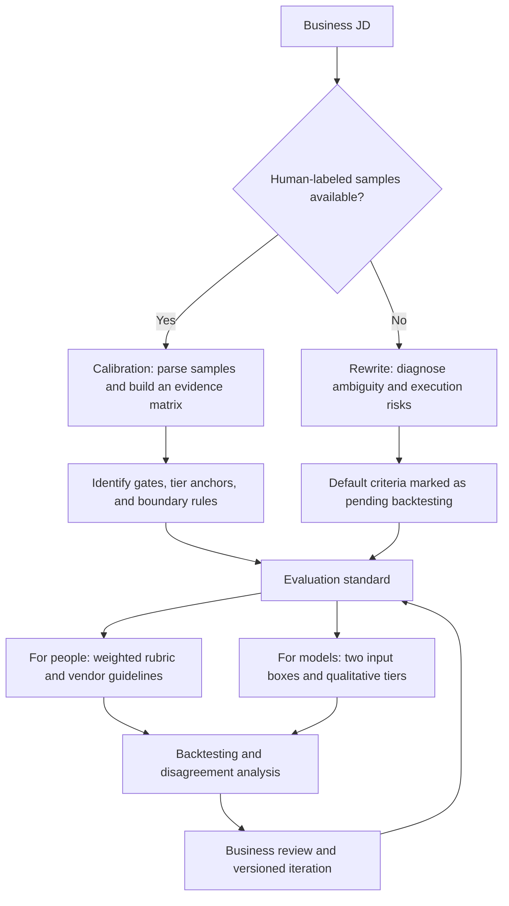

<div align="center">

# JD Evaluation Calibrator

### Turn recruiting expertise into explicit, testable AI evaluation criteria

Calibrate job descriptions, evaluation rubrics, and model inputs when the evaluation model is frozen and integration options are limited.

[简体中文](README.md) · **English**


[Project value](#project-value) · [Workflow](#workflow) · [Getting started](#getting-started) · [Results](#results-and-how-to-read-them) · [Architecture](#architecture-evolution-and-technology-choices)

</div>

---

## Project value

When an AI resume evaluator disagrees with human reviewers, the problem may lie in how evaluation criteria are expressed. People understand the flexibility of phrases such as “preferred,” “related experience,” and “for example.” A model may instead treat them as mandatory gates, keyword whitelists, or absolute requirements.

This project translates those ambiguities into **role capabilities, experience tiers, boundary rules, and evidence requirements**, then checks the rules against historical samples with human judgments. The available intervention is the JD text accepted by an existing system; the current workflow does not change model weights or the model's system prompt.

| Business problem | Approach | Value |
| --- | --- | --- |
| Suitable candidates are rejected because of literal interpretations | Separate mandatory gates, bonus signals, and transferable experience | Reduce rule misinterpretation and improve AI–human agreement |
| Recruiting criteria live mainly in reviewers' heads | Extract tier definitions, equivalence rules, and corrections from samples | Make expertise explicit, reviewable, and transferable |
| HR, vendors, and models apply different standards | Produce both human-facing rubrics and model-facing input text | Adapt the same business standard to different users |
| Prompt changes lack a clear validation process | Backtest historical samples and categorize disagreements | Make iterations inspectable |
| Existing systems cannot support the ideal AI architecture | Validate interfaces before choosing RAG or fine-tuning | Connect technical choices to actual deployment constraints |

**Project records report AI–human agreement improving from 55% to 70%, a gain of 15 percentage points.** The underlying dataset, sample size, and complete experimental configuration are not public, so this result is not independently reproducible from the repository. It describes agreement in a specific business setting, not general recruiting accuracy. See [results and how to read them](#results-and-how-to-read-them).

**Author's role:** primary contributor and AI evaluation workflow designer, covering error analysis, criteria calibration, Skill packaging, backtesting methodology, and the design and feasibility assessment of a feedback-loop architecture.

## What is available

| Component | Status | Entry point |
| --- | --- | --- |
| Calibration and JD rewrite workflows | Packaged as Skill v4.1.0 | [SKILL.md](jd-eval-calibrator/SKILL.md) |
| 17 misjudgment patterns and equivalence templates | Included as reference knowledge | [Pattern library](jd-eval-calibrator/references/misjudgment-patterns.md) |
| Weighted rubrics, tier anchors, and backtesting requirements | Methods and templates provided | [Rubric design](jd-eval-calibrator/references/rubric-design.md) |
| Responsibilities and requirements input boxes | Two-box templates provided | [Prompt templates](jd-eval-calibrator/references/prompt-templates.md) |
| Error Case RAG feedback loop | Architecture proposal; service not implemented | [Architecture notes](docs/architecture.md) |
| Fine-tuning | Feasibility exploration; no training or validation completed | [Route comparison](docs/architecture.md#技术路线比较) |

The repository contains **Skill instructions, reference rules, and methodology documents**. Execution requires an LLM host with file-reading and document-generation tools. It does not contain a standalone web service, model-training implementation, or deployed RAG backend. Skill instructions and supporting documents are primarily in Chinese.

## Workflow



| Mode | Input | Focus | Deliverables |
| --- | --- | --- | --- |
| **Calibration** | JD and resumes with human judgments; the Skill recommends at least five samples | Evidence matrix → common criteria and boundaries → tiered rubric → backtesting | Nine-chapter criteria document, sample backtest table, and two-box prompts |
| **Rewrite** | JD only | Diagnose ambiguity → four-part rewrite → terminology and experience equivalence | Criteria and two-box prompts marked as pending backtesting |

Five samples are an operational starting point, not a statistically sufficient validation set. Reviewed human judgments provide the business reference; humans retain responsibility for final business decisions.

## Three design decisions

### 1. Anchor evaluation in role capabilities

Skill v4.1.0 addresses transferability errors in both directions: superficially similar experience can be overvalued, while differently named experience with relevant capabilities can be ignored. It first defines the work the role must perform, then checks whether resume evidence supports those capabilities.

| Ambiguous wording | Potential misinterpretation | Rewrite direction |
| --- | --- | --- |
| “Related experience preferred” | Reject anyone without that experience | Explicitly label it as a bonus, not a rejection rule |
| “Skills such as A, B, and C” | Accept only listed keywords | Use an open list and define equivalent capabilities |
| “Experience in this field” | Treat direct experience as the only valid kind | Distinguish direct, adjacent, and foundational experience |
| “Relevant background” | Infer capability from overlapping words | Define the underlying capability and both overvaluation and undervaluation risks |

See the [manually authored rewrite example](examples/jd-before-after.md), which includes an English summary.

### 2. Separate the human rubric from the model input

A full scoring table helps HR, vendors, and annotators review standards. The downstream model may already have learned scoring conventions. Source materials describe a local comparison in a digital-human role: approximately 50% agreement with explicit numeric scales versus 58% with a simplified qualitative prompt.

The current default model input therefore keeps **capability definitions, qualitative tiers, boundary rules, and few-shot judgment examples**, while leaving numeric weights in the human-facing document. This choice comes from a specific observation and needs validation on the target model; it is not a universal claim that qualitative prompts always work better.

### 3. Convert disagreements into reusable rules

Each correction describes both the interpretation to avoid and the intended action, linked to a known error pattern. The current method updates the Skill through human backtesting. The proposed Error Case RAG extension would organize confirmed cases into retrievable context.

## Getting started

1. [Download the Skill package](jd-eval-calibrator%20%282%29.skill) and import it into a compatible host, or inspect the [source directory](jd-eval-calibrator). Installation depends on the host; this repository has no standalone launch command.
2. Provide a JD. For calibration, also provide authorized, de-identified historical samples with reviewed human judgments and reasons. Without samples, use rewrite mode.
3. Ask the host to perform a task such as:

```text
Use jd-eval-calibrator in rewrite mode for the JD below.
Identify wording that an AI evaluator could misinterpret.
Produce evaluation criteria and separate text blocks for the
Responsibilities and Requirements input boxes.
No historical samples are available, so mark default rules as
pending backtesting.

[JD]
Paste responsibilities and requirements here.
```

4. Paste the generated blocks into the corresponding fields of the existing evaluation tool. Run known samples and inspect disagreements. These changes affect business input fields, while the model's system prompt remains unchanged.

**Expected outputs:** evaluation document, revised JD, dimensions and tiers, terminology and experience-equivalence tables, boundary and correction rules, and two-box prompts. Calibration adds a sample evidence matrix and backtest table. File generation depends on the host's document tools.

## Results and how to read them

| Figure in source materials | Scope | Interpretation |
| --- | --- | --- |
| **55% → 70%** | Business scenario described in project records | AI–human agreement improved by **15 percentage points**; no public dataset for independent reproduction |
| **100%** | Selected historical calibration samples | Reported in-sample alignment and a Skill backtesting target; not accuracy on new samples |
| **About 50% → 58%** | Local prompt comparison for a digital-human role | Observation after removing numeric scales; a separate comparison from the 55% → 70% result |
| **≥85% / <10%** | Error Case RAG proposal | Agreement and error-recurrence targets, not validated outcomes |

Agreement is defined as `samples where AI and reviewed human judgments match / total evaluated samples`. Fitting calibration cases is a debugging step. Independent holdout evaluation should inspect both false rejections and false approvals to avoid overfitting known cases. See the [evaluation methodology and evidence limits](docs/evaluation.md).

## Architecture evolution and technology choices

The Error Case RAG proposal follows a feedback loop: capture disagreements → obtain human confirmation → structure cases → retrieve relevant correction rules → augment subsequent evaluations.

**The architecture review recorded that the existing evaluation service mainly accepts structured JD and resume data, with no direct interface for external context injection.** Dynamic retrieval augmentation therefore requires interface extensions and prompt assembly before integration is feasible.

Another explored route is to turn historical cases into an offline evaluation dataset and assess fine-tuning feasibility. That route still requires model access, suitable training data, and independent validation. Model freezing remains the constraint for the current Skill; fine-tuning is a future option only if those constraints change.

The architectural contribution is connecting business objectives, interface limitations, and technical choices. The [feedback-loop design and route comparison](docs/architecture.md) and [illustrative case record](examples/error-case.schema-example.json) are provided as design artifacts, with their status distinguished from the packaged Skill.

## Repository guide

```text
.
├── README.md / README.en.md
├── jd-eval-calibrator (2).skill      # Importable package matching the source below
├── jd-eval-calibrator/
│   ├── SKILL.md                     # Two workflows and deliverable requirements
│   └── references/
│       ├── rubric-design.md
│       ├── misjudgment-patterns.md
│       └── prompt-templates.md
├── docs/
│   ├── architecture.md             # Feedback loop and integration constraints
│   ├── evaluation.md               # Metric definitions and validation plan
│   └── publication-notes.md        # Version, source, and publication notes
└── examples/
    ├── jd-before-after.md           # Manually authored illustration
    └── error-case.schema-example.json
```

## Next priorities

- Build independent holdout evaluations, broken down by job family and error type.
- Verify that downstream parsing and truncation preserve the intended input rules.
- When interfaces permit, test a small Error Case RAG prototype for retrieval quality, conflicting rules, and recurrence.
- Add case confirmation states, versioning, deduplication, and retirement rules before expanding usage.

This project demonstrates **business problem diagnosis, LLM evaluation design, structured human feedback, and architecture decisions under deployment constraints**. It complements [Bilibili Knowledge Assistant](https://github.com/SimonLecake/bilibili-knowledge-assistant), which demonstrates an implemented knowledge-retrieval application.
