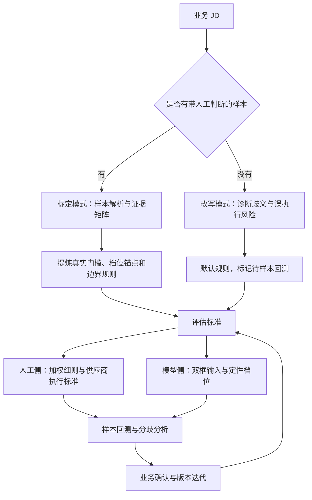

<div align="center">

# JD Evaluation Calibrator

### 把招聘经验转化为可执行、可回测的 AI 评估标准

在模型冻结、输入受限的企业环境中，通过 JD 标定、评估细则和人工反馈，改善 AI 与业务判断的一致性。

**简体中文** · [English](README.en.md)


[项目价值](#项目价值) · [工作流程](#工作流程) · [快速使用](#快速使用) · [效果与口径](#效果与口径) · [架构演进](#架构演进与技术路线)

</div>

---

## 项目价值

AI 简历评估与 HR 判断不一致时，问题可能出在评估标准的表达：人能理解“优先”“相关经验”“例如”等词的弹性，模型却可能把它们执行为硬门槛、关键词白名单或绝对条件。

本项目将这些模糊要求转化为 **岗位能力定义、经验档位、边界规则和证据要求**，再用带人工判断的历史样本回测。优化入口是既有系统允许编辑的 JD 文本，无需在当前流程中修改模型权重或系统提示词。

| 业务问题 | 项目做法 | 产生的价值 |
| --- | --- | --- |
| 合适的候选人因字面要求被错误拒绝 | 区分硬门槛、加分项与可迁移经验 | 减少规则误读，改善人机判断一致性 |
| 招聘标准依赖 HR 的隐性经验 | 从样本提炼档位、认定表、纠正规则 | 将经验沉淀为可讨论、可交接的标准 |
| HR、供应商和模型执行口径不同 | 同时交付人工评分细则与模型输入文本 | 让同一业务标准适配不同执行者 |
| 调整提示词后无法判断是否有效 | 历史样本回测，记录误判类型与分歧原因 | 将迭代变成可检查的评估过程 |
| 企业系统不支持理想中的 AI 方案 | 先验证接口，再比较 RAG 与微调前提 | 把技术选择落实到真实系统约束 |

**实践记录：AI–人工判定一致率由 55% 提升至 70%，增加 15 个百分点。** 该结果来自作者的项目记录；公开仓库未提供原始评估数据、样本量和完整实验配置，尚不能独立复现。它描述特定业务场景的一致性，不代表通用招聘准确率。详见[效果与口径](#效果与口径)。

**作者角色：** 主要贡献者与 AI 评估流程设计者，负责误判分析、标准标定、Skill 封装、回测方法设计，以及反馈闭环的架构设计与技术路线评估。

## 当前交付了什么

| 组成 | 状态 | 查看入口 |
| --- | --- | --- |
| 双模式 JD 标定与改写工作流 | 已封装为 Skill v4.1.0 | [SKILL.md](jd-eval-calibrator/SKILL.md) |
| 17 类误判模式与认定表模板 | 已收录为参考知识 | [误判模式库](jd-eval-calibrator/references/misjudgment-patterns.md) |
| 加权细则、档位锚点与回测要求 | 已定义方法和模板 | [Rubric 设计](jd-eval-calibrator/references/rubric-design.md) |
| 岗位职责框 + 岗位要求框 | 已提供双框输入模板 | [Prompt 模板](jd-eval-calibrator/references/prompt-templates.md) |
| Error Case RAG 反馈闭环 | 架构设计，尚未实现服务 | [架构与路线评估](docs/architecture.md) |
| Fine-tuning | 可行性探索，尚未训练或验证 | [路线比较](docs/architecture.md#技术路线比较) |

仓库交付的是 **Skill 指令、参考规则和方法文档**。执行需要具备文件读取与文档生成能力的 LLM 宿主；仓库没有独立 Web 服务、模型训练代码或已部署的 RAG 后端。

## 工作流程



| 模式 | 输入 | 处理重点 | 交付 |
| --- | --- | --- | --- |
| **标定模式** | JD + 带人工判断的简历样本；Skill 建议至少 5 份 | 证据矩阵 → 共性与边界 → 权重与档位 → 回测 | 九章细则、样本回测表、双框 Prompt |
| **改写模式** | 仅 JD | 识别歧义 → 四段式改写 → 同义词与等效经验认定 | 标注“待回测”的细则与双框 Prompt |

“至少 5 份”是启动标定的操作建议，不是证明泛化效果所需的统计样本量。人工判断作为经业务确认的参照，最终业务判断由人工负责。

## 三个关键设计

### 1. 从关键词匹配转向岗位核心能力

Skill v4.1.0 将经验可迁移性拆成两个方向：既避免把字面相近的背景直接当作核心胜任力，也避免把名称不同、能力相近的经验判为零相关。先定义岗位真正要完成的任务，再判断简历证据能否支持对应能力。

| 模糊表述 | 可能的误执行 | 改写方向 |
| --- | --- | --- |
| “相关经验优先” | 无该经验即拒绝 | 明确为加分信号，不作为否决条件 |
| “A、B、C 等相关技能” | 只接受列出的关键词 | 开放式枚举，加上等效能力认定 |
| “有某领域经验” | 直接经验与可迁移经验二选一 | 分级描述直接、相邻和基础经验 |
| “相关背景” | 字面相近就高估，名称不同就低估 | 定义核心能力，并给出双向误判边界 |

参见[人工编写的改写示例](examples/jd-before-after.md)。

### 2. 人工评分细则与模型输入分别设计

完整评分表适合 HR、供应商及标注人员审阅；部署端模型可能已有自己的打分先验。材料记录了一个局部对比：完整数值刻度版一致率约 50%，去刻度精简版为 58%。

因此当前默认模型输入保留**能力定义、定性档位、边界规则和 few-shot 判定示例**，不强制附加另一套数值分数；数值权重仍保留在人工细则中。这个选择来自特定场景的观察，仍需在目标模型上回测，不能外推为所有模型的通用结论。

### 3. 将误判转化为可复用的规则

每条纠正规则同时说明“哪种解释不成立”和“应如何认定”，并关联具体误判模式。当前方法通过人工回测更新 Skill；未来的 Error Case RAG 设计进一步把确认后的案例组织为可检索的上下文。

## 快速使用

1. [下载 Skill 包](jd-eval-calibrator%20%282%29.skill)，导入支持该格式的宿主；或直接浏览 [Skill 源码目录](jd-eval-calibrator)。安装方式取决于宿主，仓库不提供独立启动命令。
2. 提供 JD。若有授权使用并脱敏的历史样本，附上人工结论及理由，使用标定模式；没有样本则使用改写模式。
3. 在宿主中提出任务，例如：

```text
请使用 jd-eval-calibrator 的改写模式处理以下 JD。
指出可能被 AI 误执行的表述，生成评估细则，
并分别输出“岗位职责框”和“岗位要求框”的文本。
本次没有历史样本，请将默认规则标注为待回测。

【JD】
在此粘贴岗位职责和任职要求。
```

4. 将生成的两段文本填入现有评估工具的相应输入框，以已确认样本试跑并核对分歧。模型侧系统 Prompt 保持原状，修改的是业务输入字段。

**预期交付：** 评估细则文档、修订 JD、维度与档位、同义词和等效经验认定表、边界与纠正规则、双框 Prompt；标定模式另含样本证据矩阵和回测表。文档生成是否可用取决于宿主的文件工具。

## 效果与口径

| 材料中的数字 | 所属范围 | 公开展示时的解释 |
| --- | --- | --- |
| **55% → 70%** | 项目记录中的业务场景 | AI–人工判定一致率，提升 **15 个百分点**；没有公开数据供独立复现 |
| **100%** | 选定的历史标定样本 | 材料报告的样本内对齐结果；Skill 也将其设为回测目标，不代表新样本准确率 |
| **约 50% → 58%** | 数字人岗位的 Prompt 局部对比 | 去掉数值刻度后的观察结果；不能与上一组数字合并成同一实验 |
| **≥85% / <10%** | Error Case RAG 方案 | 一致率与错误复发率的设计目标，尚未达成验证 |

一致率定义为：`AI 与经确认人工结论一致的样本数 / 已评估样本总数`。对齐标定集是调试步骤，下一步需使用独立留出集，同时检查错误通过与错误拒绝，防止只修正已知案例而过拟合。详见[评估方法与证据边界](docs/evaluation.md)。

## 架构演进与技术路线

Error Case RAG 的设计目标是：收集人机分歧 → 人工确认原因 → 形成结构化案例 → 检索相关纠正规则 → 增强下一次评估。

**架构验证记录指出，现有评估调用链主要接收结构化 JD 与简历，未提供外部上下文注入接口。** 因此，动态检索增强需要先具备接口扩展和 Prompt 组装能力。已探索的另一条路线是把历史案例用于离线评估集，并进一步评估微调的可行性；这仍取决于模型访问能力、数据质量和独立验证。

这部分体现的项目价值是：把业务目标、接口约束和技术路线放到同一个决策中。完整的[闭环架构、职责划分和路线比较](docs/architecture.md)与[示例案例结构](examples/error-case.schema-example.json)均已提供，设计状态与当前 Skill 交付分开标注。

## 仓库导航

```text
.
├── README.md / README.en.md
├── jd-eval-calibrator (2).skill      # 可导入包，与下方源码一致
├── jd-eval-calibrator/
│   ├── SKILL.md                     # 双模式工作流与交付要求
│   └── references/
│       ├── rubric-design.md
│       ├── misjudgment-patterns.md
│       └── prompt-templates.md
├── docs/
│   ├── architecture.md             # 反馈闭环与架构约束
│   ├── evaluation.md               # 指标口径与验证计划
│   └── publication-notes.md        # 版本、来源与公开处理说明
└── examples/
    ├── jd-before-after.md           # 人工编写的说明性示例
    └── error-case.schema-example.json
```

## 后续重点

- 建立独立留出集与按岗位、误判类型划分的评估报告。
- 验证输入字段是否完整传入模型，避免规则在结构化或截断时丢失。
- 在接口允许后验证小规模 Error Case RAG，比较召回、冲突规则和复发情况。
- 为案例增加确认状态、版本、去重及失效规则，再评估扩大应用范围。

本项目展示了**业务问题诊断、LLM 评估标准设计、人工反馈组织和受约束的架构决策**。它与 [Bilibili Knowledge Assistant](https://github.com/SimonLecake/bilibili-knowledge-assistant) 分别体现评估校准与知识检索应用两类实践。
