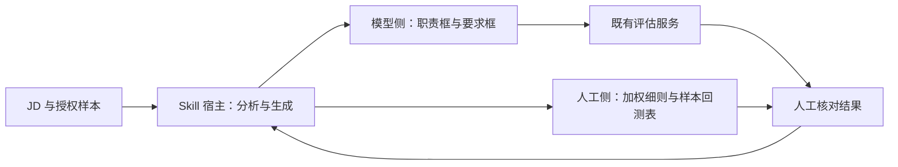
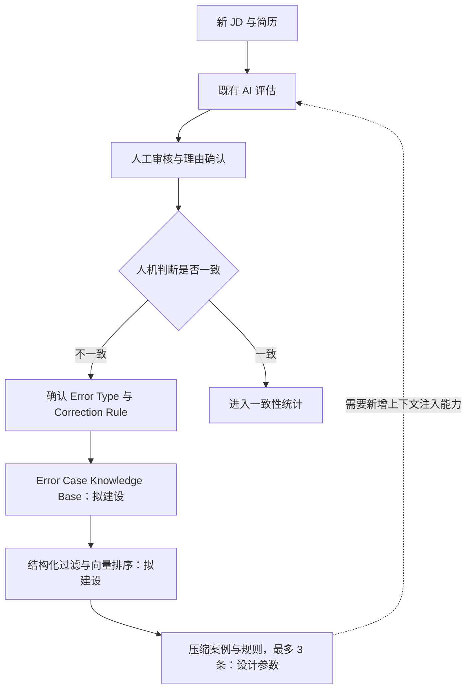

# 从 JD 标定到 Error Case RAG

[返回首页](../README.md) · [Evaluation notes](evaluation.md)

本文区分当前可用的 Skill、反馈闭环设计，以及实施前发现的接口约束。RAG 检索服务、反馈页面和模型微调均未在本仓库实现。

## 当前可用路径

Skill 运行在支持文件读取、LLM 推理和文档生成的宿主中，输出人工评估细则与可填入既有工具的两个文本框。它不直接连接企业招聘系统。

优化的是允许编辑的业务输入。下游模型权重和系统 Prompt 不属于当前 Skill 的修改范围。下游若会抽取、重写或截断 JD，必须验证新增规则是否仍被保留；能填写输入框不等于所有文字都会进入模型上下文。

## 反馈闭环设计

业务人员确认分歧原因后，把案例沉淀为纠正规则。下一次评估检索相近案例，将压缩后的规则加入上下文。图中“检索”和“注入”均为拟建设能力。

### 案例记录

原始设计包含八个字段：`JD`、`Resume`、`AI_Decision`、`AI_Reasoning`、`Human_Decision`、`Human_Reasoning`、`Error_Type`、`Correction_Rule`。

治理设计进一步提出 `Case_Status`、`Job_Family`、`Trigger_Feature`、时间戳与 `Recurrence_Count`。公开[示例 JSON](../examples/error-case.schema-example.json)展示这些字段，不代表已实现 JSON Schema 校验器、存储层或 API。

| 设计项 | 方案 | 状态与实施前提 |
| --- | --- | --- |
| 检索 | 先按岗位族、触发特征及可获得的错误类型过滤，再做向量排序 | 设计；新案例的错误类型未知时不能假定过滤键已存在 |
| 注入内容 | 一句式案例 + 纠正规则，最多 3 条 | 设计参数，需实测；避免注入整份历史 JD 与简历 |
| 冷启动 | 使用经确认的种子案例和已有误判模式库 | 数据准备方案，需脱敏并检查适用范围 |
| 规则确认 | HR 确认错误类型、判断理由与纠正规则 | 人工确认是入库前提 |
| 辅助归因 | LLM 推荐错误类型、根因和修正规则 | 仅辅助，未经人工确认的建议不直接入库 |
| 知识治理 | 待确认 / 已确认 / 已废弃；去重、合并、版本与冲突检查 | 待实施 |
| 度量 | 一致率与同类错误复发率，按月复查 | 方案目标，不代表已有自动统计服务 |

### 职责分工

| 角色 | 职责 |
| --- | --- |
| HR / 招聘业务 | 提供最终判断和理由，确认业务标准与错误类型 |
| 业务平台团队 | 提供反馈入口，采集 JD、简历及人机评估数据 |
| AI 应用团队 | 管理案例知识、检索、Prompt 组装与 Skill 版本 |
| 模型团队 | 在权限与条件允许时评估模型优化或微调 |

## 架构验证发现

V4 补充材料记录：现有评估链路主要使用结构化 JD 和简历，没有直接注入外部案例、动态 Prompt 或附加规则的接口。

这意味着 Error Case RAG 的落地至少需要三个条件：

1. **Context Injection：** 模型调用确实能接收额外上下文。
2. **接口扩展：** 上游与评估服务约定额外数据的格式、长度及边界。
3. **Prompt 组装：** 明确案例如何与现有规则结合，以及冲突时的处理顺序。

材料中的结论是发现实施依赖并重新评估路线，没有证明 RAG 已接通生产链路。

## 技术路线比较

| 路线 | 适用条件 | 价值 | 代价与边界 | 当前状态 |
| --- | --- | --- | --- | --- |
| JD / 输入文本标定 | 允许编辑业务输入且规则能够保留 | 在冻结模型条件下调整业务标准的表达 | 依赖输入解析、长度限制和模型遵循能力 | 已封装 Skill |
| Error Case RAG | 允许检索与额外上下文注入 | 案例可更新、来源可追踪、无需改变权重 | 需要接口改造、知识治理与检索验证 | 架构方案 |
| Fine-tuning | 可以访问训练能力或协调模型团队 | 有机会把高质量案例用于模型行为优化 | 需要足量标注、训练与部署能力，仍需独立评估 | 可行性探索 |
| 独立评估集 | 可获得授权、经确认的数据 | 为以上所有路线提供统一比较依据 | 需要拆分标定集与留出集，维护数据质量 | 方法与准备方向 |

模型冻结是当前交付的约束。微调属于未来在约束允许时的候选路线，不能作为已实施方案描述。输入层优化、RAG 与微调也并非互相替代，最终选择应取决于可用接口与独立评估结果。
