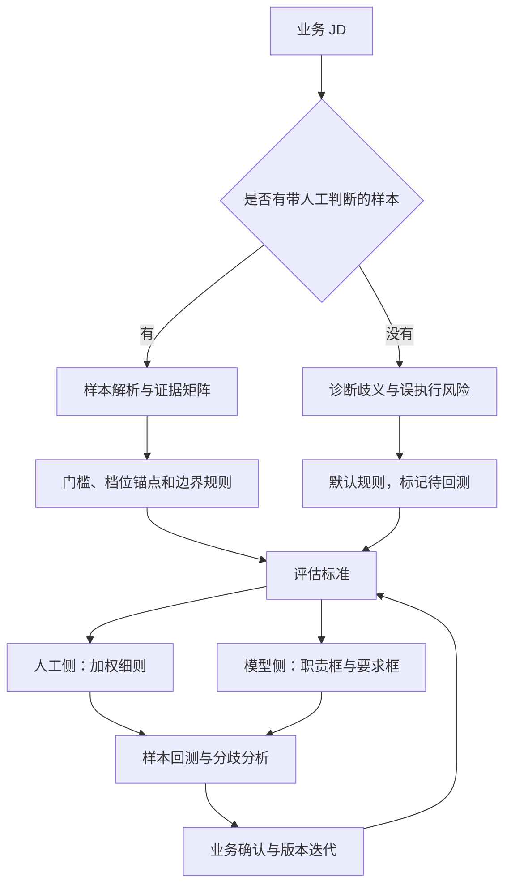

# 工作流与设计取舍

[返回首页](../README.md) · [English overview](../README.en.md#how-it-works)

本页展开首页的简化流程：怎样从 JD 和人工判定样本提炼标准，以及为什么人工细则与模型输入采用不同表达。

## 两种输入模式

| 模式 | 输入 | 过程 | 交付 |
| --- | --- | --- | --- |
| 标定模式 | JD + 带人工结论与理由的历史样本 | 解析样本 → 证据矩阵 → 门槛与边界 → 权重与档位 → 回测 | 九章细则、样本矩阵、回测表、双框 Prompt |
| 改写模式 | 仅 JD | 诊断歧义 → 四段式改写 → 同义词与等效经验认定 | 默认细则、双框 Prompt，注明待样本回测 |

Skill 建议至少 5 份样本作为启动材料，通过与拒绝样本均有更佳。该数量不是统计充分性声明。纯误拒样本可用于定位假阴性，但无法验证错误通过率。

## 先定义岗位能力，再认定经验

v4.1.0 的重要补充是可迁移性判断的双向边界：

- **避免高估：** 字面相近的背景未必能支持岗位的核心任务。例如，仅列出内容管理工具，不等于具备来源核验和版本维护能力。
- **避免低估：** 项目名称不同，也可能具有相同能力证据。例如，帮助中心维护中包含来源核对、分类和版本更新，可作为知识内容维护的相关证据。

先明确核心交付物，再检查实际任务与成果，最后将经验归入合适档位。不要仅凭职位名、专业名或工具关键词做判断。[完整示例](../examples/jd-before-after.md)与[17 类误判模式](../jd-eval-calibrator/references/misjudgment-patterns.md)展示了不同颗粒度的规则。

## 人工细则与模型文本分开设计

| 交付通道 | 主要读者 | 内容 | 用途 |
| --- | --- | --- | --- |
| 加权细则文档 | HR、供应商、标注人员 | 维度、权重、数值档位、边界、样本锚点 | 审阅、培训、回测与标准交接 |
| 岗位职责框 | 下游评估模型 | 原职责 + 核心交付物与评估导引 | 帮助模型理解岗位任务 |
| 岗位要求框 | 下游评估模型 | 门槛、定性档位、认定规则、禁令、加分信号、few-shot | 约束规则解释与判断路径 |

材料记录了数字人岗位的局部对比：完整数值刻度版与人工一致率约 50%，去刻度精简版为 58%。当前默认模型文本因此采用定性档位，将数值权重保留在人工文档中。

这个观察不证明定性规则适用于所有模型。具体模型是否存在数值刻度冲突，仍需控制条件进行回测；该局部数字也不能与项目记录中的 55% → 70% 合并为同一个实验。[指标口径](evaluation.md)

## 交付结构

标定模式定义九章文档：背景逻辑、样本分析、修订 JD、维度权重、同义词与等效认定、否决与边界规则、误判纠正、样本回测、落地建议。改写模式省略样本分析与回测结果，标记为待回测。

双框 Prompt 同步作为可复制文本交付，并收入文档附录。实际导出依赖宿主的文件工具；这是 Skill 的交付要求，不是仓库内自带的文档生成服务。

## 从单次修正到持续改进

每条纠正规则都应关联一个误判机制，说明不应采用的解释以及正确的认定动作。人工确认后更新规则版本，并用新样本复查是否出现新的错误通过或错误拒绝。

当前以人工回测更新 Skill；未来 Error Case RAG 的设计将这类经确认案例转成可检索上下文。能否实施取决于[下游接口及上下文注入能力](architecture.md#架构验证发现)。

## English summary

The Skill routes inputs into sample-based calibration or JD-only rewriting. Calibration derives explicit criteria from evidence and reviewed human labels; rewriting produces defaults marked as pending backtesting. Human-facing documents retain numeric rubrics, while the default model input uses qualitative tiers and examples. This split follows a local observation about conflicting scoring conventions and requires validation on the target model. Human review and independent holdout evaluation remain distinct from fitting the calibration samples.
